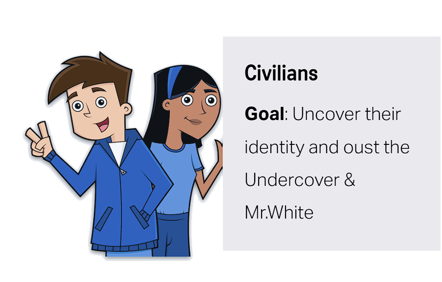
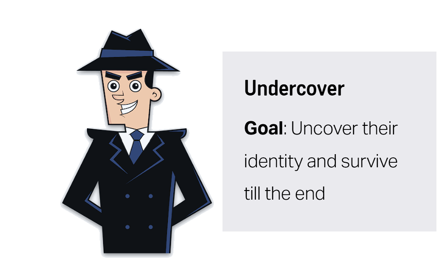
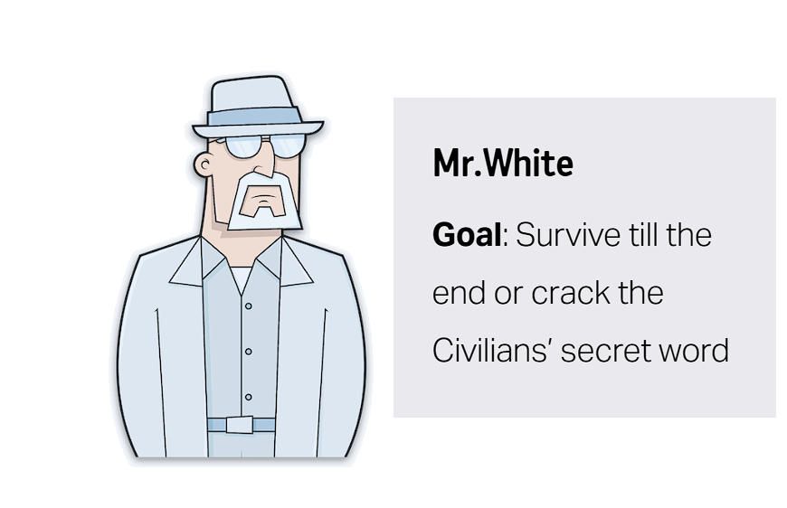

<h1 align="center">
Undercover word game
</h1>

<h4 align="center">The <a href="https://www.yanstarstudio.com/de/undercover-game" target="_blank">Undercover</a> word exposing game for the web!</h4>

<p align="center">
    <a href="https://undercover.localplayer.dev/">
        
    </a>
    <a href="https://github.com/antebrl/undercover-word-game/actions/workflows/deploy.yml">
        
    </a>
</p>

<!-- Add a gif video here -->
<!--  -->

This is a web-version of the popular [Undercover App](https://play.google.com/store/apps/details?id=com.yanstarstudio.joss.undercover). I made this so that you can play Undercover remotely with your friends. You can either play together online (each player on their own device) or locally by passing a single phone or tablet around.

The game uses peer-to-peer WebRTC communication with [PeerJS](https://github.com/peers/peerjs), so there is no central game server storing your matches.

👉 **Play it here:** https://undercover.localplayer.dev/

Undercover is a social deduction word game similar to **Werewolf** or **Among Us**.

---

# Explanation

A small group of Impostors has appeared in the game. They have a different word than the others and must hide. Civilians have to discover them.

### Roles and Goals

There are 3 groups in the game: Civilians, Undercover and Mr.White. The majority of the residents are the peace-loving Civilians. There are up to two groups of Impostors: Undercover and Mr.White.

<p align="center">
  
  
  
</p>

---

## Get your secret word

At the beginning of the game, everyone receives a secret word. Each game uses a pair of secret words. Remember to keep your secret word hidden from the others.

- **Civilians** receive the same secret word.
- **Undercovers** receive a word that is slightly different from the Civilians'.
- **Mr.White** doesn't receive any word at all.

At this point, you don't know who is on your team. You have to figure it out during the game.

---

## Gameplay

### Description Phase

As soon as everyone has received their secret word, a random player is assigned to start describing their word.

Going around the table, every player describes their word using a single word or short phrase.

Mr.White has to improvise since they don't know the secret word.

Use this phase to reveal just enough information to identify your teammates while avoiding giving away the answer.

### Discussion Phase

Once everyone has given a clue, the discussion begins.

Players debate who they believe is an Undercover or Mr.White.

Civilians and Undercovers use this phase to gather clues, build trust and identify suspicious players. Meanwhile, Mr.White tries to figure out the Civilian word without revealing that they never had one.

Remember: revealing too much too early is usually a bad idea.

### Elimination Phase

After the discussion, every remaining player votes for someone to eliminate.

The player with the most votes is removed from the game.

If the eliminated player turns out to be **Mr.White**, they get one final chance to guess the Civilian word. If they guess correctly, Mr.White wins immediately.

If nobody has won yet, another round begins.

---

## Victory

- **Civilians** win if they eliminate every Undercover and Mr.White.
- **Undercovers** win if they survive until only one Civilian remains.
- **Mr.White** also wins by correctly guessing the Civilian word after being eliminated.

---

# Special Roles

Besides the three main roles, the game also supports optional **Special Roles** that add new mechanics and make every game feel different.

The host can enable or disable them before the game starts. Every player privately receives their special role together with their secret word.

| Role | Description |
|------|-------------|
| ⚖️ **Goddess of Justice** | Breaks tied votes by choosing who gets eliminated, even after being eliminated themselves. |
| ❤️ **Lovers** | Two players are secretly linked. If one is eliminated, the other is eliminated as well. |
| 💀 **Revenger** | After being eliminated, immediately chooses one remaining player to eliminate too. |
| 👻 **Ghost** | Can continue participating in discussions and voting after being eliminated. |
| 🤡 **Joy Fool** | Receives bonus points if they are the first player eliminated in the game. |
| 🪃 **Boomerang** | The first time they would be eliminated, every player who voted against them is eliminated instead while they survive. |
| ⚔️ **Duelists** | Two players secretly compete. The one who survives longer earns bonus points. |
| 🥙 **Falafel Vendor** | At the start of every round, secretly gives a random effect to another player. |
| 🎭 **Mr. Meme** | May only communicate using emojis while giving clues. |

Special Roles are completely optional and are disabled by default, allowing you to mix and match whichever roles you want for your group.

For developers interested in creating additional roles, see **SPECIAL_ROLES_README.md**.

---

# Offline / Local Mode

The game can also be played entirely on a single device.

Simply enter all player names, then pass the phone or tablet around the table. Each player privately reveals their word and role before handing the device to the next person.

Voting works the same way by hiding the screen between turns, ensuring everyone's choices remain secret.

All normal gameplay mechanics and Special Roles work exactly the same in Offline Mode.

---

# Self-Host

If you want to run the web project yourself, follow these steps:

```sh
# Clone the repository
git clone https://github.com/antebrl/undercover-word-game.git

# Go into the project
cd undercover-word-game

# Install dependencies
npm install

# Start the development server
npm run dev
```

Open:

```
http://localhost:8080
```

The project works through peer-to-peer WebRTC communication using [PeerJS](https://github.com/peers/peerjs).

---

# Contribute & Support

If you enjoy the game, consider leaving a ⭐ on the repository.

Contributions are always welcome, including:

- New word pairs
- New translations
- Bug fixes
- UI improvements
- New Special Roles

If you're interested in implementing your own Special Role, check out **SPECIAL_ROLES_README.md**, which explains where the role logic lives and which files need to be updated.